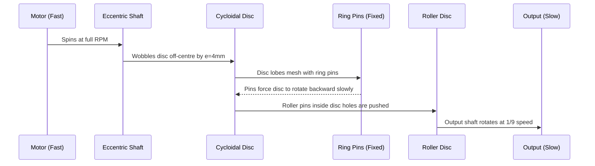
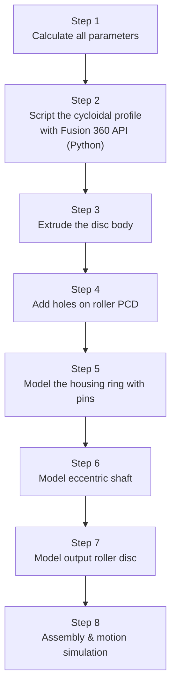
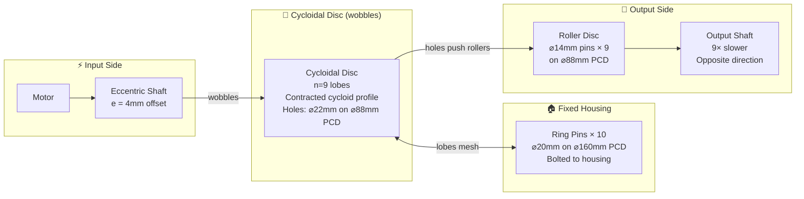

# 🔩 Complete Cycloidal Gearbox Guide — Design, Theory & Fusion 360

> **Sources:** tec-science.com — [How it works](https://www.tec-science.com/mechanical-power-transmission/planetary-gear/how-does-a-cycloidal-gear-drive-work/) + [Construction of the disc](https://www.tec-science.com/mechanical-power-transmission/planetary-gear/construction-of-the-cycloidal-disc/)

---

## Part 1 — What Is It and Why Should You Care?

### The Big Idea in Plain English

A cycloidal gearbox slows down a fast spinning motor into a slow, powerful output. The genius part: it does this using a **wobbling disc with lobes** instead of regular gear teeth.

**Why it's better than a planetary gearbox at high ratios:**

| Feature | Planetary Gear | Cycloidal Drive |
|---------|---------------|-----------------|
| Shock load resistance | Moderate | ✅ Very high |
| Backlash (play/slop) | Moderate | ✅ Near zero |
| Positioning accuracy | Good | ✅ Excellent |
| Mass at high ratio | Heavy | ✅ Lighter & compact |
| Service life | Good | ✅ Longer |
| Best use below ratio 20 | ✅ Better here | Less efficient |
| Robotics / servo drives | OK | ✅ Ideal |

> [!TIP]
> If you're building a robot arm, CNC rotary axis, or anything needing **precise, high-ratio, high-torque rotation** — cycloidal is the right choice.

---

## Part 2 — How It Actually Works (Step by Step)

### The 5 Physical Parts

```
┌────────────────────────────────────────────────────────────────┐
│                                                                │
│  1. INPUT (ECCENTRIC) SHAFT  ← spins fast from motor          │
│       └─ offset by eccentricity e from centre                 │
│                                                                │
│  2. CYCLOIDAL DISC           ← the wobbling heart of it all   │
│       └─ shaped like a cycloid curve (n lobes)                │
│       └─ holes for output roller pins                         │
│                                                                │
│  3. FIXED HOUSING RING PINS  ← N pins bolted to the housing   │
│       └─ the disc's lobes roll around these                   │
│                                                                │
│  4. OUTPUT ROLLER DISC       ← picks up the slow rotation     │
│       └─ roller pins pass through the disc holes              │
│                                                                │
│  5. OUTPUT SHAFT             ← coaxial with input, slow & strong│
│                                                                │
└────────────────────────────────────────────────────────────────┘
```

### What Happens When You Spin the Input?



### The Wobble Explained Visually

```
TOP VIEW — one full input revolution:

  Input turns 360°           Disc moves back 1 lobe
  ─────────────────          ───────────────────────
  
  Lobe 1 → Pin 1  ┐
  Lobe 2 → Pin 2  │  All 10 pins engaged
  Lobe 3 → Pin 3  │  sequentially during
  ...             │  one full rotation
  Lobe 9 → Pin 9  ┘
  
  But only 9 lobes for 10 pins
  → disc is 1/9 behind per revolution
  → 9 input turns = 1 output turn = 9:1 ratio
```

> **Key insight:** Because there's always **1 more ring pin than disc lobes**, the disc can never complete a full revolution in the same direction as the input. It slips back by exactly 1 lobe per revolution. That slip = your output rotation.

> [!NOTE]
> The output rotates **opposite direction** to the input. This is because the disc rolls on the *inside* of the ring pin circle. If you need same-direction rotation, add a 1:1 reversing stage or account for this in your design.

### Two-Disc Design (Used in Real Builds)

In practice, **two cycloidal discs offset 180°** are used:
- Unbalance forces from disc 1 cancel disc 2
- Smoother operation at high RPM
- Higher torque capacity
- Much less vibration

> [!IMPORTANT]
> For any build spinning above ~500 RPM or carrying real load, **always use two discs offset 180°**. Single-disc builds are fine for prototypes and low-speed applications.

---

## Part 3 — The Math (All Formulas Explained)

### Formula 1 — Gear Ratio

$$\boxed{i = \frac{n}{N - n}}$$

| Symbol | Meaning |
|--------|---------|
| $i$ | Transmission ratio |
| $n$ | Lobes on the cycloidal disc |
| $N$ | Fixed housing ring pins |

**Golden rule:** Set $N - n = 1$, then $i = n$ (simplest and most common).

**Examples:**

| $N$ (pins) | $n$ (lobes) | Ratio $i$ |
|-----------|-----------|----------|
| 10 | 9 | **9:1** |
| 10 | 7 | **7:3 = 2.33:1** |
| 25 | 24 | **24:1** |
| 101 | 100 | **100:1** ← one stage! |

---

### Formula 2 — Rolling Circle Diameter

$$\boxed{\delta = \frac{D}{N}}$$

| Symbol | Meaning | Example |
|--------|---------|---------|
| $\delta$ | Rolling circle diameter | 16 mm |
| $D$ | Pitch circle diameter of ring pins | 160 mm |
| $N$ | Number of ring pins | 10 |

> The rolling circle must fit exactly $N$ times around the ring pin circle so lobes align with pins.

---

### Formula 3 — Base Circle Diameter

$$\boxed{d = \frac{i}{N} \cdot D}$$

| Symbol | Meaning | Example |
|--------|---------|---------|
| $d$ | Base circle diameter | 144 mm |
| $i$ | Gear ratio | 9 |
| $N$ | Number of ring pins | 10 |
| $D$ | Ring pin pitch circle diameter | 160 mm |

> Also derived from: $i = d/\delta$, so $d = i \cdot \delta = 9 \times 16 = 144$ mm ✅

---

### Formula 4 — Eccentricity Constraint

$$\boxed{e \leq \frac{\delta}{2}}$$

| Symbol | Meaning | Example |
|--------|---------|---------|
| $e$ | Eccentricity (wobble offset) | 4 mm |
| $\delta/2$ | Radius of rolling circle | 8 mm |

**Choosing $e$:**
- Too large → excessive vibration, structural stress
- Too small → disc becomes nearly circular, lobes disappear, **disc slips over pins**
- Good rule of thumb: $e \approx \delta/4$ to $\delta/3$

---

### Formula 5 — Hole Diameter in the Cycloidal Disc

$$\boxed{d_h = d_r + 2e}$$

| Symbol | Meaning | Example |
|--------|---------|---------|
| $d_h$ | Hole diameter in cycloidal disc | 22 mm |
| $d_r$ | Roller pin diameter (output disc) | 14 mm |
| $e$ | Eccentricity | 4 mm |

> The hole must be larger than the roller pin by $2e$ on each side to accommodate the wobble of the disc.

---

### Quick-Reference Cheat Sheet

```
─────────────────────────────────────────────────────
  GIVEN: D=160  N=10  i=9  dp=20  dr=14  dd=88

  STEP 1:  n = N - 1 = 9  lobes
  STEP 2:  δ = D / N = 16 mm          (rolling circle ⌀)
  STEP 3:  d = (i/N)·D = 144 mm       (base circle ⌀)
  STEP 4:  e ≤ δ/2 = 8mm → pick e=4mm (eccentricity)
  STEP 5:  dh = dr + 2e = 22 mm       (hole ⌀ in disc)
  STEP 6:  holes on PCD dd = 88 mm    (matches roller disc)
─────────────────────────────────────────────────────
```

---

## Part 4 — The Disc Profile: Contracted Cycloid

### Why Not an Ordinary Cycloid?

An ordinary cycloid places the drawing point at the edge of the rolling circle ($r = R$). This creates:
- ❌ High eccentricity → big vibration
- ❌ Large holes in disc → thin material between holes
- ❌ Holes too close → risk of deformation under load

### Use a Contracted Cycloid Instead ✅

The drawing point is placed **inside** the rolling circle at distance $r = e < R$.

```
  Ordinary:    r = R (point on edge)   → spiky lobes
  Contracted:  r < R (point inside)    → smooth lobes  ✅
  Extended:    r > R (point outside)   → no use in engineering
```

**Effect on the disc shape:**

```
Ordinary Cycloid Disc         Contracted Cycloid Disc
─────────────────────         ───────────────────────
  Sharp, deep lobes             Rounded, gentle lobes
  Large holes                   Smaller holes
  Thin web between holes        Thick web → stronger
  High eccentricity             Low eccentricity
  Jerky motion                  Smooth motion
```

> [!IMPORTANT]
> Gear ratio is **100% unaffected** by switching from ordinary to contracted cycloid. Only the disc shape changes — always use contracted.

---

## Part 5 — Fusion 360: Step-by-Step CAD Workflow

### Overview of the Modelling Strategy



---

### Step 1 — Set Up Parameters in Fusion 360

In Fusion 360, go to **Modify → Change Parameters** and add these user parameters:

| Parameter Name | Formula / Value | Notes |
|---------------|-----------------|-------|
| `D` | `160 mm` | Ring pin PCD |
| `N` | `10` | Number of ring pins |
| `ratio_i` | `9` | Desired gear ratio |
| `n_lobes` | `9` | = ratio_i (when N-n=1) |
| `dp` | `20 mm` | Ring pin diameter |
| `dr` | `14 mm` | Roller pin diameter |
| `dd` | `88 mm` | Roller pin PCD |
| `e` | `4 mm` | Eccentricity |
| `delta` | `D/N` | = 16 mm rolling circle ⌀ |
| `d_base` | `ratio_i/N * D` | = 144 mm base circle ⌀ |
| `dh` | `dr + 2*e` | = 22 mm hole ⌀ in disc |
| `disc_thickness` | `8 mm` | Adjust to your load |
| `pin_length` | `30 mm` | Adjust to your design |

> [!TIP]
> Using user parameters means you can change `ratio_i` or `D` and the **entire model updates automatically** — this is the power of parametric CAD!

---

### Step 2 — Generate the Cycloidal Disc Profile (Python Script)

The lobe shape **cannot be drawn with standard Fusion 360 sketch tools** — it's a mathematical curve. Use the Fusion 360 **Script editor** to generate it.

**Go to:** Tools → Add-ins → Scripts and Add-ins → New Script (Python)

Paste this script (edit your parameters at the top):

```python
import adsk.core, adsk.fusion, math

def run(context):
    ui = None
    try:
        app = adsk.core.Application.get()
        ui = app.userInterface
        design = app.activeProduct
        rootComp = design.rootComponent

        # ── USER PARAMETERS ────────────────────────────────────
        D     = 16.0   # ring pin pitch circle diameter (cm in Fusion)
        N     = 10     # number of ring pins
        ratio = 9      # gear ratio (= n_lobes when N-n=1)
        n     = 9      # number of lobes on disc
        dp    = 2.0    # ring pin diameter (cm)
        e     = 0.4    # eccentricity (cm)
        steps = 1000   # curve resolution (more = smoother)
        # ───────────────────────────────────────────────────────

        R  = D / N          # rolling circle diameter
        d  = ratio / N * D  # base circle diameter
        Rb = d / 2          # base circle radius
        Rr = R / 2          # rolling circle radius
        Rp = dp / 2         # ring pin radius (for offset)

        sketches = rootComp.sketches
        xyPlane  = rootComp.xYConstructionPlane
        sketch   = sketches.add(xyPlane)
        lines    = sketch.sketchCurves.sketchLines
        points   = []

        for i in range(steps + 1):
            t = 2 * math.pi * i / steps
            # Contracted epicycloid parametric equations
            x = (Rb + Rr) * math.cos(t) - e * math.cos((Rb + Rr) / Rr * t)
            y = (Rb + Rr) * math.sin(t) - e * math.sin((Rb + Rr) / Rr * t)
            points.append(adsk.core.Point3D.create(x, y, 0))

        # Draw the profile as connected lines (approximation)
        splines = sketch.sketchCurves.sketchFittedSplines
        col = adsk.core.ObjectCollection.create()
        for pt in points:
            col.add(pt)
        splines.add(col)

        ui.messageBox('Cycloidal profile drawn! Now extrude it.')

    except Exception as e:
        if ui:
            ui.messageBox(f'Error: {str(e)}')
```

> [!NOTE]
> Fusion 360 uses **centimetres** internally. The script above converts mm to cm (divide by 10). Double-check your values: `D=16.0` = 160 mm, `e=0.4` = 4 mm, etc.

**After running the script:**
1. The lobe spline appears on the XY plane
2. The curve is NOT closed yet — close it manually in the sketch editor or add `isClosed=True`
3. Offset the closed spline **inward by `dp/2` = 1.0 cm** using **Sketch → Offset** to get the final equidistant disc profile

---

### Step 3 — Extrude the Disc Body

1. Select your offset spline profile
2. **Create → Extrude** → Distance = `disc_thickness` (e.g. 8 mm)
3. Apply **fillets** to the lobe tips (radius ≈ 0.5 mm) to reduce stress concentrations

---

### Step 4 — Add the Roller Pin Holes

1. Create a **construction circle** on the disc face, diameter = `dd` = 88 mm
2. Place a **centre point** on the construction circle
3. Draw a circle of diameter `dh` = 22 mm at that point
4. Use **Circular Pattern** → `n_lobes` = 9 instances around the disc centre
5. Extrude-cut **Through All**

> [!WARNING]
> The holes must be centred on the **disc's geometric centre**, not the eccentric shaft hole. These are two different centres offset by `e` = 4 mm.

---

### Step 5 — Add the Eccentric Shaft Bore

1. At the **disc's geometric centre**, draw the eccentric bore
2. The bore is NOT at the disc's shape centre — it's the wobble centre
3. Diameter = your bearing OD (e.g. 20 mm for a 6004 bearing)
4. Extrude-cut Through All

---

### Step 6 — Model the Housing Ring (Fixed Pins)

1. Create a new component: **Housing**
2. Sketch a circle of diameter `D + dp + 2×wall` for the outer ring
3. Inner bore = `D - dp` (just clears pin tips from inside)
4. Place `N` = 10 circles of diameter `dp` = 20 mm on a PCD of `D` = 160 mm using **Circular Pattern**
5. Extrude the ring to height = `2 × disc_thickness + clearance`
6. The pins can be:
   - **Extruded bosses** (integral, for 3D print)
   - **Bored holes** for press-fit ground steel pins (best for precision)

---

### Step 7 — Model the Eccentric Shaft

```
Shaft layout (from motor end):
  
  [Motor coupling] → [Bearing journal] → [Eccentric lobe] → [Bearing journal] → [end cap]
                                              ↑
                                      offset by e=4mm from shaft axis
```

1. Revolve the main shaft body (concentric, matches your bearing bore)
2. Add an **eccentric lobe**: a cylinder of diameter = `bearing OD`, positioned `e` = 4 mm off-axis
3. For two-disc design: add a second eccentric lobe **180° offset** from the first
4. Add keyway or flat if driving from a motor shaft

---

### Step 8 — Model the Output Roller Disc

1. Create a disc of diameter slightly smaller than the cycloidal disc holes PCD
2. Place `n_lobes` = 9 roller pin holes on PCD `dd` = 88 mm using **Circular Pattern**
3. Roller pin holes = `dr` = 14 mm diameter (press-fit for roller pins)
4. Add a central output shaft bore (concentric with the housing, NOT eccentric)

---

### Step 9 — Assembly & Motion Simulation

1. **Ground** the housing component
2. Add **Rigid Group** joints for the ring pins to the housing
3. Add **Revolute Joint** between eccentric shaft and housing (input axis)
4. Add **Revolute Joint** between output roller disc and housing (output axis)
5. The cycloidal disc gets a **Rigid Joint** to the eccentric lobe (it wobbles with it)
6. Use **Motion Link** to link input and output rotations with ratio `1 : ratio_i`

> [!TIP]
> Fusion 360's **Contact Sets** can simulate the actual lobe-to-pin contact, but it's heavy. For validation, use **Motion Link** at the correct ratio and visually confirm the disc meshes properly.

---

## Part 6 — Full Assembly Diagram



---

## Part 7 — Tolerances & Materials for Real Builds

### Recommended Tolerances

| Feature | Tolerance | Why |
|---------|-----------|-----|
| Eccentric shaft offset `e` | ±0.01 mm | Critical — errors cause binding |
| Ring pins (ground pins) | h6 | Standard precision shaft |
| Pin holes in housing | H7 | Clearance fit |
| Roller pin holes in disc `dh` | +0.1 to +0.2 mm extra | Smooth wobble, no binding |
| Disc lobe profile | ±0.05 mm | Surface quality matters |
| Bearing bores | H7 | Standard bearing fit |

### Material Recommendations

| Part | 3D Print Prototype | Metal Build |
|------|-------------------|-------------|
| Cycloidal disc | PETG or Resin | Hardened steel or aluminium 7075 |
| Ring pins | Ground steel rod (buy stock) | Ground steel rod |
| Eccentric shaft | PLA+ (low torque only) | 4140 steel, hardened |
| Housing | PLA or PETG | Aluminium 6061 |
| Roller pins | Ground steel rod | Ground steel rod or needle rollers |

> [!CAUTION]
> Never 3D print the eccentric shaft for load-bearing use. The eccentric feature is under combined bending + torsion. Use a metal shaft even for prototypes under real load.

---

## Part 8 — Design Checklist Before You Build

- [ ] $n = N - 1$ verified (or rationally chosen)
- [ ] $\delta = D/N$ calculated
- [ ] $d = (i/N) \times D$ calculated
- [ ] $e \leq \delta/2$ satisfied (and not too close to 0)
- [ ] $d_h = d_r + 2e$ calculated
- [ ] Holes positioned on correct PCD $d_d$
- [ ] Contracted cycloid profile used (not ordinary)
- [ ] Two discs at 180° if RPM > 500 or under real load
- [ ] Fusion 360 parameters set up (fully parametric model)
- [ ] Python script used to generate lobe profile
- [ ] Inward offset by $d_p/2$ applied to get equidistant profile
- [ ] Clearances checked in assembly (no clashes)
- [ ] Bearing selected for eccentric shaft
- [ ] Output shaft is coaxial with input shaft

---

## Part 9 — Worked Example Summary (Printable Reference)

```
════════════════════════════════════════════════
  CYCLOIDAL GEARBOX DESIGN — WORKED EXAMPLE
════════════════════════════════════════════════

TARGET RATIO:  9:1
OUTPUT DIR:    Opposite to input

── RING (HOUSING) ──────────────────────────────
  Ring pin PCD:         D  = 160 mm
  Ring pin diameter:    dp =  20 mm
  Number of ring pins:  N  =  10

── CYCLOIDAL DISC ──────────────────────────────
  Number of lobes:      n  =   9
  Rolling circle ⌀:    δ  =  16 mm   [= D/N]
  Base circle ⌀:       d  = 144 mm   [= i/N × D]
  Eccentricity:         e  =   4 mm   [≤ δ/2 = 8mm]
  Hole diameter:        dh =  22 mm   [= dr + 2e]
  Hole PCD:             dd =  88 mm   [= roller disc PCD]
  Profile type:         Contracted cycloid

── OUTPUT ROLLER DISC ──────────────────────────
  Roller pin diameter:  dr =  14 mm
  Roller pin PCD:       dd =  88 mm
  Number of rollers:    9  (= n lobes)

── RATIO CHECK ─────────────────────────────────
  i = n / (N - n) = 9 / (10 - 9) = 9 ✅

════════════════════════════════════════════════
```

---

## Appendix — Resources & Next Steps

| Resource | Link |
|----------|------|
| tec-science: Operating Principle | https://www.tec-science.com/mechanical-power-transmission/planetary-gear/how-does-a-cycloidal-gear-drive-work/ |
| tec-science: Construction | https://www.tec-science.com/mechanical-power-transmission/planetary-gear/construction-of-the-cycloidal-disc/ |
| Fusion 360 Scripting Docs | https://help.autodesk.com/view/fusion360/ENU/?guid=GUID-A92A4B10-3781-4925-94C6-47DA85A4F65A |
| Parametric Cycloid Generator | Search: "cycloidal drive Fusion 360 add-in GitHub" |
| Bearing selection (eccentric) | Deep groove ball bearings — SKF 6000 series |
